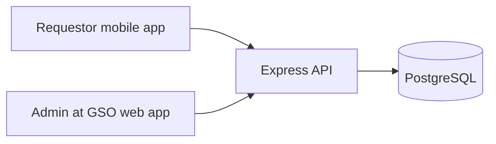

# Mobile Request Center (kasama ang Borrowing) — Brainstorm Notes

> **Status:** Brainstorming draft lamang. Request Center ito para sa mga awtorisadong school requestors; ang paghiram ay isa lang sa mga serbisyo. Hindi pa ito pinal na requirements.

## Kaya ba itong gawin sa React Native?

Oo. Puwedeng gumawa ng hiwalay na React Native app para sa mga awtorisadong school requestors habang nananatili sa kasalukuyang React web app ang Admin at GSO. Puwedeng gamitin ng lahat ang kasalukuyang Express API at PostgreSQL. Hindi kailangang gumawa ng hiwalay na backend para lang magkaroon ng mobile app.

May borrower role, registration, email verification, at borrower dashboard na sa kasalukuyang code. Pero wala pang persisted submission workflow para sa asset borrowing o sa ibang request forms. Nakalista na sa kasalukuyang GSO UI ang Purchase Request, Job Request, Permit to use School Facilities, Request for Services, at Permit to use School Vehicle, pero sample data pa ang request queue. Kaya feasible ang mobile interface, pero kailangan munang planuhin at buuin ang bawat request workflow at access rules bago ito maging end-to-end na gumagana. Nasa [ForBorrowers.md](./ForBorrowers.md) ang brainstorm para sa apat na paper forms na ipinadala.

## Ano ang puwedeng i-reuse at ano ang iaangkop?

- **Puwedeng i-reuse:** Express API, PostgreSQL, kasalukuyang account at verification concepts, at business rules na maitatakda para sa bawat request type.
- **Iaangkop para sa mobile:** navigation, forms, list at detail screens, loading/error states, at optional na camera o file attachment.
- **Hindi direktang maililipat mula sa web:** browser-specific `sessionStorage`, `window.location`, at web UI components. Kailangan ng mobile-friendly na authentication/token storage at React Native components.
- **Iminungkahing project arrangement:** panatilihin ang `frontend/` para sa Admin at GSO web; gumawa ng hiwalay na `mobile/` app para sa Request Center kapag napagkasunduan na ang scope.

## Mga posibleng mobile screens

1. **Home** — bilang ng pending requests at active loans, susunod na due date, at mabilis na button para mag-browse o mag-request.
2. **Browse Assets** — search at filters; item name/code, category, condition, availability, at borrowing restrictions.
3. **Request Asset** — item at quantity, purpose, kailan kailangan, inaasahang return date, at pickup details; may summary ng patakaran at validation bago isumite.
4. **My Activity** — request list, status timeline, decision reason, due date, at susunod na kailangang gawin. Puwedeng magkansela kung pinapayagan at hindi pa naaaprubahan.
5. **My Loans / Return** — active loans, due dates, at paraan para humiling o magsimula ng return. GSO pa rin ang magkukumpirma ng aktuwal na pagtanggap at kondisyon ng item.
6. **Notifications** — pagbabago ng status at paalala; puwedeng magsimula sa in-app notifications at idagdag ang push notifications sa susunod.
7. **Profile** — pangalan, email, school ID, borrower type, at department/program o grade/section kung kailangan; account verification at sign-out. Kolektahin lamang ang impormasyong kailangan ng proseso.

## Mga request category bukod sa paghiram

Maaaring ilagay sa Request Center ang mga sumusunod na card, batay sa access ng user:

- **Borrow an Asset** — available equipment at borrowing history.
- **Permit to Use School Facilities** — venue, schedule, participants, at equipment.
- **Job / Service Request** — work order o serbisyong kailangan ng department.
- **Purchase Requisition** — item quantity/specifications at approval tracking.
- **Loss / Damage Report** — incident report para sa school property.
- **Vehicle Permit** — nasa GSO UI ang request type, pero kailangan pa ang official form at policy.

Ang **Request Center** ay maaaring nasa bottom navigation kapalit ng Browse; sa loob nito ilagay ang asset catalog at lahat ng form categories. Ang Notifications ay puwedeng bell icon sa header. Panatilihin ang sariling form at status workflow ng bawat category; huwag gawing iisang generic form ang magkakaibang proseso.

**Iminungkahing bottom navigation:** Home, Request Center, My Requests, Profile. Ang borrowing-specific list gaya ng Browse Assets at My Loans ay maaaring sub-page sa Request Center o Home.

## Iminungkahing asset borrowing flow (isang serbisyo sa Request Center)

1. Mag-sign in ang borrower at pumili ng available na asset.
2. Isumite ang request kasama ang purpose at mga petsa.
3. Suriin ng system kung kumpleto ang request at pasok sa eligibility at availability rules.
4. Aprubahan o tanggihan ito ng GSO; magbigay ng dahilan kapag tinanggihan.
5. Kapag approved, ipakita sa borrower ang pickup instructions. Itatala ng GSO ang aktuwal na pag-issue at due date.
6. Magpaalala tungkol sa due date kung may notification feature.
7. Simulan ng borrower ang return process. Susuriin at kukumpirmahin ng GSO ang aktuwal na pagbabalik at kondisyon ng asset.
8. I-update ang inventory availability o markahan ang item para sa repair, at itala ang status history.

Para sa Facility Use, Job Request, Purchase Requisition, at Loss/Damage Report, tingnan ang kani-kanilang workflow at mga open question sa [ForBorrowers.md](./ForBorrowers.md). Magkakaiba ang approval, validation, at completion rules ng mga ito.

> Ang pag-tap ng borrower sa “Return” ay request o abiso lamang; hindi nito dapat awtomatikong ituring na naibalik na ang asset bago ito ma-inspect at matanggap ng GSO.

## MVP at mga puwedeng idagdag pagkatapos

### MVP na puwedeng pag-usapan

- Login at basic requester profile/access
- Request Center, My Requests, at status timeline
- Browse/search ng borrowable assets
- Request form para sa purpose at petsa
- In-app status notices
- Asset borrowing, Facility Use, at Job Request workflows
- GSO review queue sa kasalukuyang web app

### Mga susunod na opsyon

- Push notifications
- QR o barcode scan para sa pickup at return
- Photo attachment para sa kondisyon ng asset
- Request renewal/extension
- Read-only offline cache
- Favorites o saved assets
- Purchase Requisition, Loss/Damage Report, Vehicle Permit, at iba pang service forms kapag malinaw na ang policies at approvals

## Mga tanong para sa brainstorming

1. Sino ang puwedeng maging requestor—students, faculty, staff, at department/organization representatives? Alin sa kanila ang puwedeng humiram ng assets?
2. Aling mga asset ang puwedeng hiramin, at alin ang hindi puwede?
3. Kailangan ba ang school ID, institutional email, department/program, o grade/section?
4. GSO lang ba ang approval, o kailangan din ng department head o ibang approver?
5. Quantity lang ba ang ite-track, o kailangang pumili ng partikular na asset batay sa serial number/tag?
6. Ano ang maximum na dami ng items at haba ng loan? Puwede ba ang renewal? Ano ang pickup at late-return rules?
7. Aling request types ang isasama sa unang release, at alin ang ilalagay sa susunod na phase?
8. Android muna ba ang target, o kailangan ding suportahan ang iOS?

## Candidate API ideas para sa susunod na planning

Mga pangalan lang itong mungkahi para mapag-usapan; wala pang binagong backend. Borrowing endpoints lang ang mga ito; kailangan pang idisenyo ang request contracts para sa ibang service forms.

- `GET /borrower/assets` — listahan ng borrowable assets
- `GET /borrower/requests` — sariling requests ng borrower
- `POST /borrower/requests` — gumawa ng request
- `GET /borrower/requests/:id` — detalye at status history ng sariling request
- `POST /borrower/requests/:id/cancel` — magkansela kung pinapayagan ng status
- `POST /borrower/loans/:id/return-request` — mag-abiso o humiling ng return

Kailangang tiyakin sa susunod na backend work na borrower-only ang borrowing routes at sariling records lang ng borrower ang mababasa o maa-update niya. Para sa ibang request types, kailangan ng angkop na requestor access rules. GSO ang mananatiling may kontrol sa approval at inventory issue/return records.

## Mungkahing susunod na pag-usapan

Unahin ang dalawang scope decision: **sino ang puwedeng mag-submit ng bawat request type** at **alin ang isasama sa unang release**. Kapag malinaw ang mga iyon, mas madaling itakda ang form fields, approval flows, statuses, screens, at API contracts.

---

**Tala:** Brainstorm document lamang ito. Wala pang binagong application code o backend.
